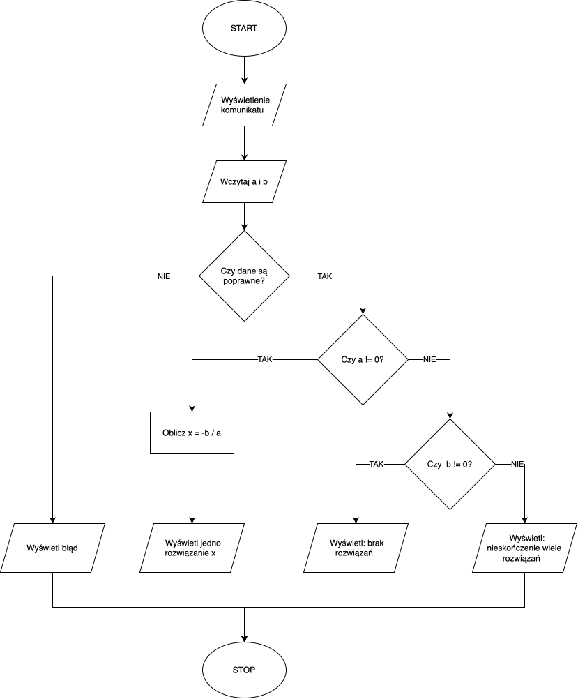
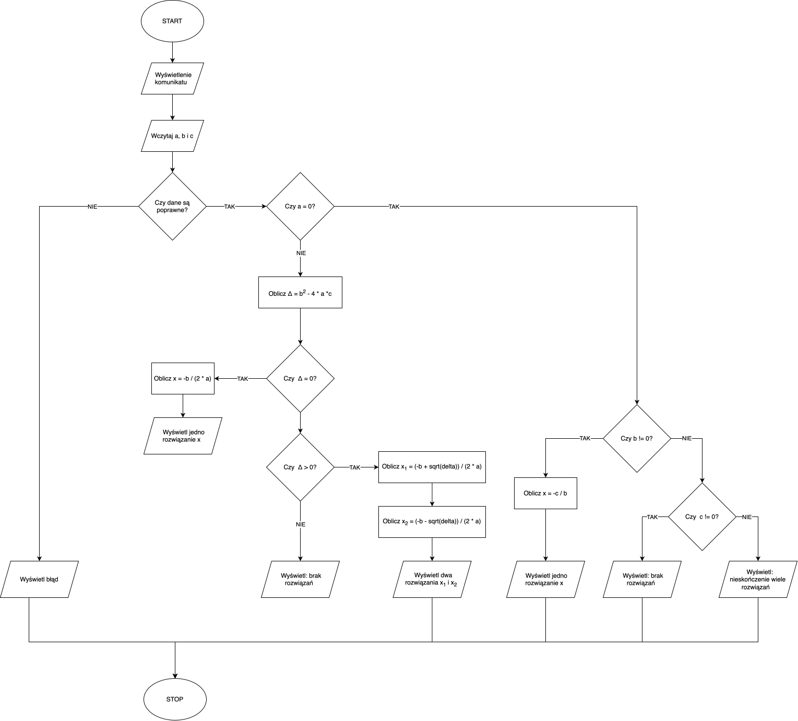

# Lab 1

[Repozytorium github](https://github.com/yet3/wsiz-wstep-do-programowania/tree/main/lab-1)

## Zad 1: 

#### A) Sprawdź w interpreterze typ wyników określonych działań - type( x ) i wyjaśnij, co oznaczają poszczególne operatory?

```python
# 1)
print(type(1 + 2))
# <class 'int'> (liczba całkowita)
# wynik: 3
# operator: + (dodawanie)

# 2)
print(type(1 + 4.5))
# <class 'float'> (liczba zmiennoprzecinkowa)
# wynik: 5.5
# operator: + (dodawanie; dodanie int do float daje float)

# 3)
print(type(3 / 2))
# <class 'float'> (liczba zmiennoprzecinkowa)
# wynik: 1.5
# operator: / (dzielenie zmiennoprzecinkowe)

# 4)
print(type(4 / 2))
# <class 'float'> (liczba zmiennoprzecinkowa)
# wynik: 2.0
# operator: / (dzielenie zmiennoprzecinkowe)

# 5)
print(type(3 // 2))
# <class 'int'> (liczba całkowita)
# wynik: 1
# operator: // (dzielenie całkowite)

# 6)
print(type(-3 // 2))
# <class 'int'> (liczba całkowita)
# wynik: -2
# operator: // (dzielenie całkowite)

# 7)
print(type(11 % 2))
# <class 'int'> (liczba całkowita)
# wynik: 1
# operator: % (reszta z dzielenia)

# 8)
print(type(2 ** 10))
# <class 'int'> (liczba całkowita)
# wynik: 1024
# operator: ** (potęgowanie)

# 9)
print(type(8 ** (1/3)))
# <class 'float'> (liczba zmiennoprzecinkowa)
# wynik: 2.0
# operator: ** (potęgowanie)

```

#### B) Sprawdź i wyjaśnij działanie następujących instrukcji

```python
# 1)
print(int(3.0))
# wynik: 3
# działanie: konwersja liczby zmiennoprzecinkowej na całkowitą

# 2)
print(float(3))
# wynik: 3.0
# działanie: konwersja liczby całkowitej na zmiennoprzecinkową

# 3)
print(float("3"))
# wynik: 3.0
# działanie: konwersja tekstu na liczbę

# 4)
print(str(12.4))
# wynik: "12.4"
# działanie: konwersja liczby na tekst

# 5)
print(bool(0))
# wynik: False
# działanie: konwersja liczby na wartość True/False
```

## Zad 2: Do zmiennej o nazwie uczelnia przypisz zdanie Studiuję na WSIiZ, Następnie korzystając z funkcji `print()` wydrukuj ten tekst do konsoli.

```python
uczelnia = "Studiuję na WSIiZ"

print(uczelnia)
```

## Zad 3: Podane są poniższe zmienne: `imię = 'Jan'`, `wiek = 20`, `wzrost = 178`. Wykorzystując funkcję `print()` oraz podane zmienne wydrukuj poniższy tekst do konsoli: `Nazywam się Jan i mam 20 lat.` oraz `Mój wzrost to 178 cm.`

```python
imie = 'Jan'
wiek = 20
wzrost = 178

print(f"Nazywam się {imie} i mam {wiek} lat.")
print(f"Mój wzrost to {wzrost} cm.")
```

## Zad 4: Do zmiennej `cena` przypisz cenę produktu równą 39.99 PLN oraz do zmiennej `rabat` przypisz wartość 0.2 (rabat 20%). Następnie policz cenę tego produktu po zastosowaniu podanego rabatu. Wynik wydrukuj do konsoli. Zwróć uwagę na odpowiednie formatowanie tekstu w funkcji `print()` tak, aby końcowa cena produktu została wyświetlona tylko do drugiego miejsca po przecinku.

```python
cena = 39.99
rabat = 0.2
print(f"Cena po rabacie to {cena * (1-rabat):.2f} PLN")
```

## Zad 5: Napisz skrypt, który pobiera długości boków prostokąta, a następnie oblicza jego pole i obwód oraz wyświetla wyniki na ekranie.

```python
def main():
    print("Kalkulator pola i obwódu prostokąta")

    try:
        a = float(input("Podaj bok a: "))
        b = float(input("Podaj bok b: "))
    except ValueError:
        print("\nWprowadzona wartość jest błędna!")
        return

    p = a * b
    obw = 2 * a + 2 * b

    print("")
    print(f"Pole prostokąta to: {p}")
    print(f"Obwód prostokąta to: {obw}")


main()
```

## Zad 6: Napisz skrypt, który pobiera od użytkownika drogę pokonaną przez samochód oraz średnie spalanie (w litrach na 100 km) i wyświetli informację o przewidywanym zużyciu paliwa oraz o szacowanych kosztach podróży (cena paliwa 6.5 zł/l).

```python
CENA_PALIWA_ZA_L = 6.5


def main():
    print("Kalkulator paliwa")

    try:
        droga = float(input("Podaj przebytą drogę (km): "))
        spalenie = float(input("Podaj średnie spalenie litra na 100km: "))
    except ValueError:
        print("\nWprowadzona wartość jest błędna!")
        return

    spalono = droga * spalenie / 100

    print("")
    print("Spalono:", round(spalono, 2), "l")
    print("Koszt:", round(spalono * CENA_PALIWA_ZA_L, 2), "PLN")


main()
```

#### A) Zmodyfikuj skrypt tak, aby długość przejechanej drogi była generowana losowo (liczba całkowita z zakresu 20–150), a użytkownik podawał aktualną cenę paliwa za litr.

```python
import random


def main():
    print("Kalkulator paliwa (losowa droga 20-150)")
    droga = random.randint(20, 150)

    try:
        spalenie = float(input("Podaj średnie spalenie litra na 100km: "))
        cena_paliwa_za_l = float(input("Podaj cene paliwa za l: "))
    except ValueError:
        print("\nWprowadzona wartość jest błędna!")
        return

    spalono = droga * spalenie / 100

    print("")
    print("Droga:", droga, 'km')
    print("Spalono:", round(spalono, 2), "l")
    print("Koszt:", round(spalono * cena_paliwa_za_l, 2), "PLN")


main()
```

#### B) Zmodyfikuj zadanie 6 tak, aby wyświetlanie wyników wykorzystywało f-string.

```python
CENA_PALIWA_ZA_L = 6.5


def main():
    print("Kalkulator paliwa")

    try:
        droga = float(input("Podaj przebytą drogę (km): "))
        spalenie = float(input("Podaj średnie spalenie litra na 100km: "))
    except ValueError:
        print("\nWprowadzona wartość jest błędna!")
        return

    spalono = droga * spalenie / 100

    print("")
    print(f"Spalono: {round(spalono, 2)} l")
    print(f"Koszt: {round(spalono * CENA_PALIWA_ZA_L, 2)} PLN")


main()
```

## Zad 7: Narysuj schemat blokowy algorytmu i napisz program rozwiązywania równania liniowego ax + b = 0, gdzie a i b są współczynnikami podawanymi przez użytkownika. Do rysowania schematów blokowych skorzystaj z narzędzia draw.io.

#### Schemat blokowy



#### Kod

```python
def main():
    print("Rozwiązywanie równania ax + b = 0")

    try:
        a = float(input("Podaj a: "))
        b = float(input("Podaj b: "))
    except ValueError:
        print("\nWprowadzona wartość jest błędna!")
        return

    print("")
    if a != 0:
        x = -b/a
        print(f"Równanie ma jedno rozwiązanie: x = {x}")
    else:
        if b == 0:
            print(
                "Równanie ma nieskończenie wiele rozwiązań")
        else:
            print("Równanie nie posiada żadnych rozwiązań")


main()
```

## Zad 8: Narysuj schemat blokowy algorytmu i napisz program rozwiązywania równania kwadratowego ax^2 + bx + c = 0, gdzie a, b i c są współczynnikami podawanymi przez użytkownika.

#### Schemat blokowy



#### Kod

```python
import math


def main():
    print("Rozwiązywanie równania ax^2 + bx + c = 0")

    try:
        a = float(input("Podaj a: "))
        b = float(input("Podaj b: "))
        c = float(input("Podaj c: "))
    except ValueError:
        print("\nWprowadzona wartość jest błędna!")
        return

    print("")

    if a == 0:
        if b != 0:
            x = -c/b
            print(f"Równanie ma jedno rozwiązanie: x = {x}")
        else:
            if c == 0:
                print(
                    "Równanie ma nieskończenie wiele rozwiązań")
            else:
                print("Równanie nie posiada żadnych rozwiązań")
        return

    delta = b ** 2 - 4 * a * c

    if delta == 0:
        x = -b / (2 * a)
        print(f"Równanie ma jedno rozwiązanie: x = {x}")
    elif delta > 0:
        x_1 = (-b + math.sqrt(delta)) / (2 * a)
        x_2 = (-b - math.sqrt(delta)) / (2 * a)
        print(f"Równanie ma dwa rozwiązania: x = {x_1} i x = {x_2}")
    else:
        print("Równanie nie posiada żadnych rozwiązań")


main()
```

## Zad 9: Napisz kalkulator, który wyświetli wyniki dodawania, odejmowania, mnożenia, dzielenia i potęgowania 2 liczb podanych przez użytkownika.

```python
def main():
    print("Przeliczenia")

    try:
        a = float(input("Podaj pierwszą liczbę: "))
        b = float(input("Podaj drugą liczbę: "))
    except ValueError:
        print("\nWprowadzona wartość jest błędna!")
        return

    print("")
    print(f"Dodawanie: {a + b}")
    print(f"Odejmowanie: {a - b}")
    print(f"Mnożenie: {a * b}")
    if b != 0:
        print(f"Dzielenie: {a / b}")
    else:
        print("Dzielenie: Nie można dzielić przez 0")
    print(f"Potęgowanie: {a ** b}")


main()
```

